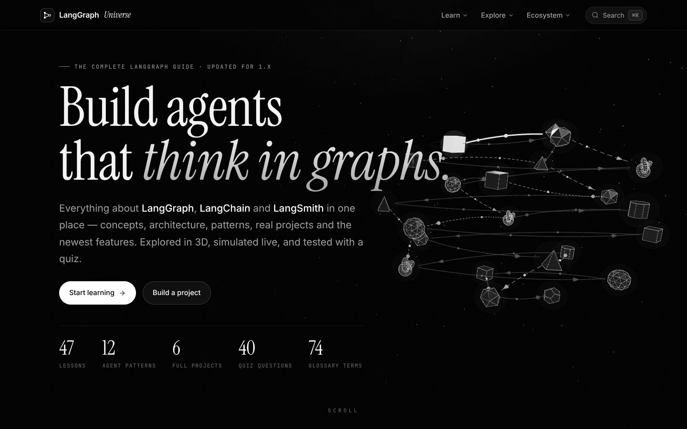
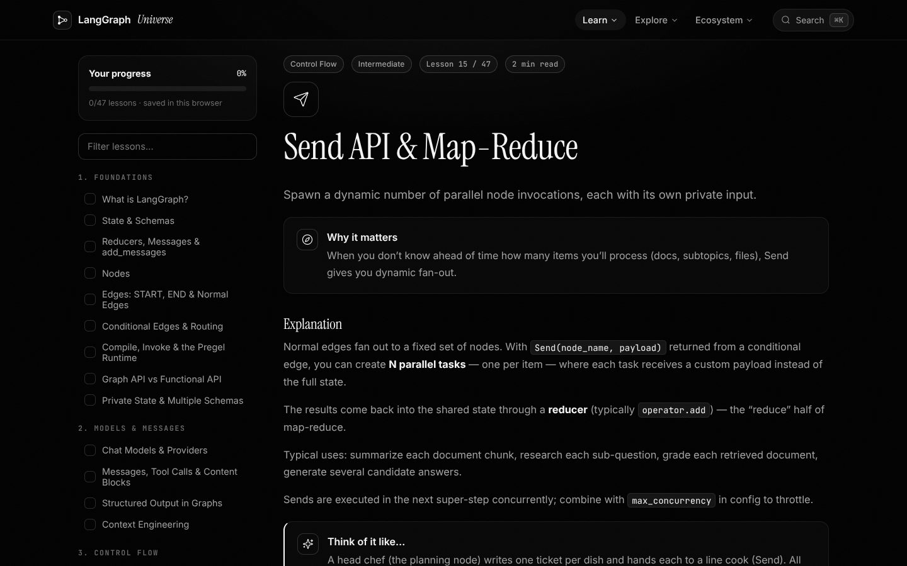
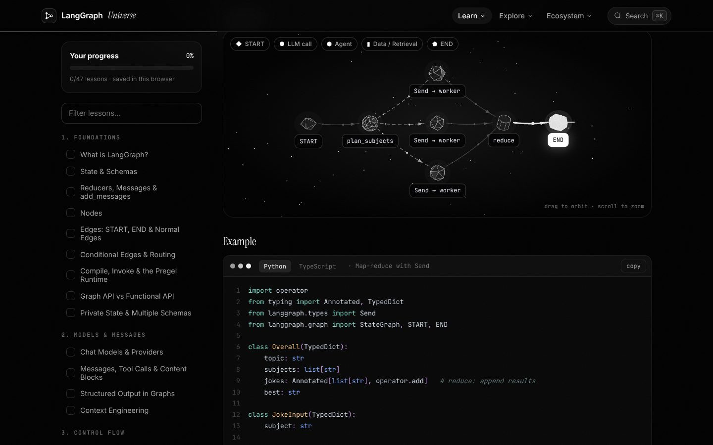
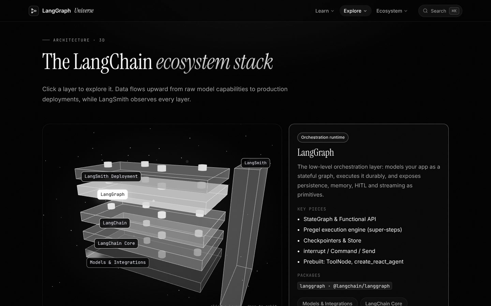
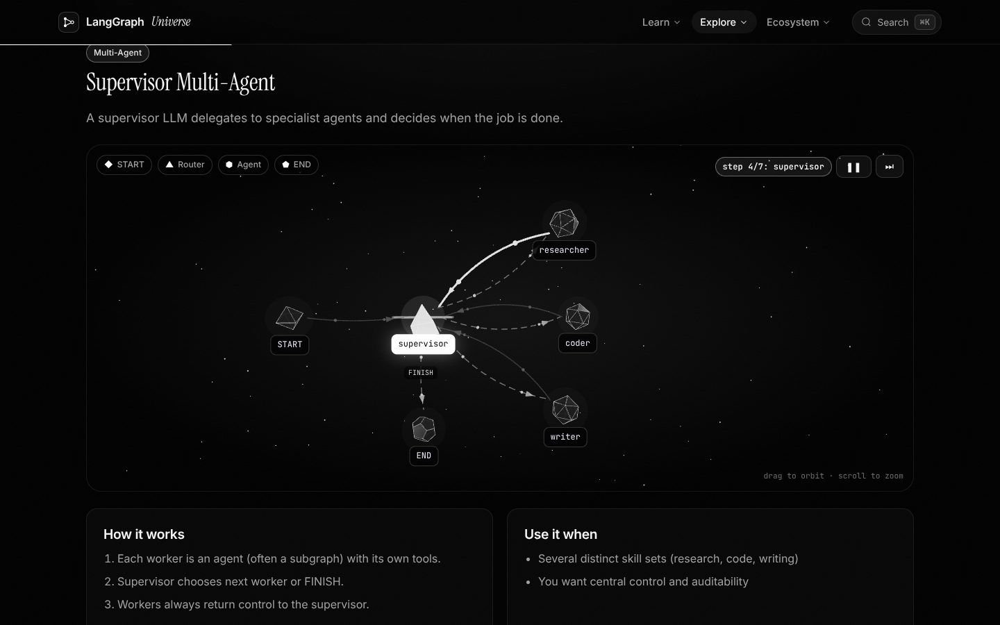
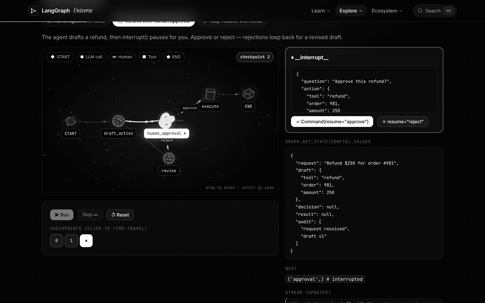
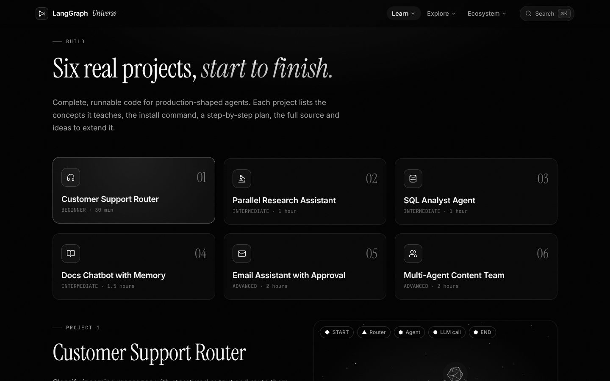
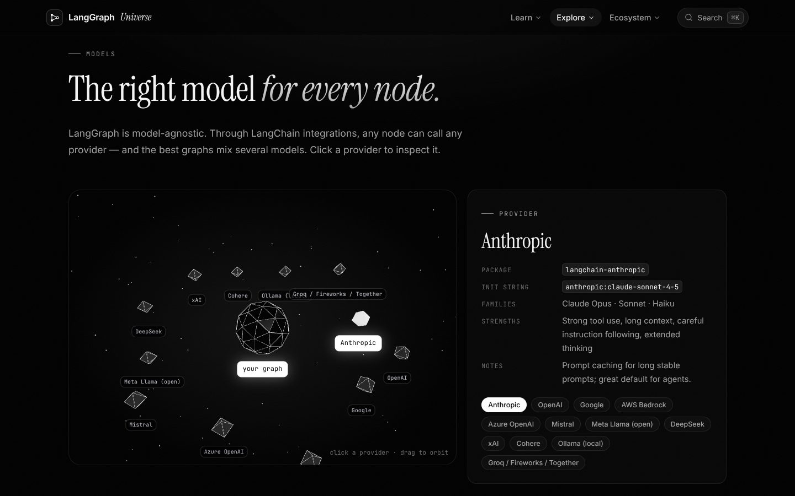
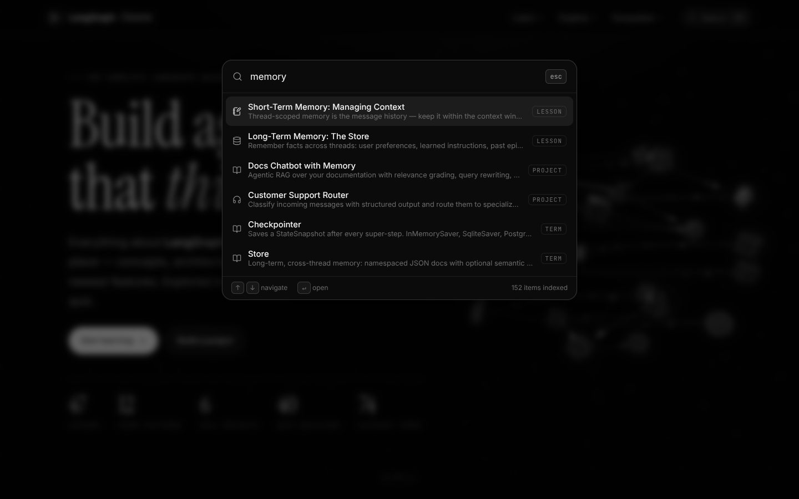
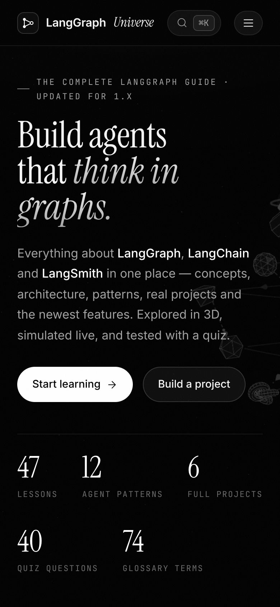

<div align="center">

# LangGraph Universe

**An interactive, 3D study guide to LangGraph and the LangChain ecosystem.**

[**Live site →**](https://atulswain.github.io/LangGraph/) &nbsp;·&nbsp; [Study Guide](https://atulswain.github.io/LangGraph/learn/) &nbsp;·&nbsp; [Projects](https://atulswain.github.io/LangGraph/projects/) &nbsp;·&nbsp; [Playground](https://atulswain.github.io/LangGraph/playground/)


<br />

<a href="https://atulswain.github.io/LangGraph/"></a>

</div>

## Screenshots

<table>
  <tr>
    <td width="50%">
      <a href="https://atulswain.github.io/LangGraph/learn/send/"></a>
      <p align="center"><b>Study Guide</b><br />47 lessons in 9 modules, with progress tracking</p>
    </td>
    <td width="50%">
      <a href="https://atulswain.github.io/LangGraph/learn/send/"></a>
      <p align="center"><b>3D diagrams + code</b><br />Python and TypeScript examples in every lesson</p>
    </td>
  </tr>
  <tr>
    <td width="50%">
      <a href="https://atulswain.github.io/LangGraph/architecture/"></a>
      <p align="center"><b>Architecture 3D</b><br />Click through the LangChain ecosystem stack</p>
    </td>
    <td width="50%">
      <a href="https://atulswain.github.io/LangGraph/patterns/supervisor/"></a>
      <p align="center"><b>Agent Patterns</b><br />12 architectures animated step by step</p>
    </td>
  </tr>
  <tr>
    <td width="50%">
      <a href="https://atulswain.github.io/LangGraph/playground/"></a>
      <p align="center"><b>Playground</b><br />Simulate runs, approve interrupts, time-travel</p>
    </td>
    <td width="50%">
      <a href="https://atulswain.github.io/LangGraph/projects/"></a>
      <p align="center"><b>Projects</b><br />Six complete, runnable agents</p>
    </td>
  </tr>
  <tr>
    <td width="50%">
      <a href="https://atulswain.github.io/LangGraph/models/"></a>
      <p align="center"><b>Models</b><br />Pick the right model for every node</p>
    </td>
    <td width="50%">
      
      <p align="center"><b>⌘K search</b><br />Find any lesson, pattern, project or term</p>
    </td>
  </tr>
</table>

<p align="center">
  
  <br /><b>Works on mobile</b>
</p>

## What's inside

A black-and-white, editorial design with 3D visualizations throughout, ⌘K search across everything, and keyboard navigation.

| Page | What you get |
| --- | --- |
| **Home** | 3D graph hero, a live animated ReAct loop, curriculum roadmap, what's new, FAQ |
| **Study Guide** | 47 lessons in 9 modules: Foundations · Models & Messages · Control Flow · Tools & Agents · Persistence & Memory · Human-in-the-Loop · Streaming & Runtime · Integrations & Ecosystem · Production. Each has an explanation, analogy, Python + TypeScript code, pitfalls and takeaways, many with an animated 3D diagram. Progress is saved in your browser; ←/→ to move between lessons. |
| **Projects** | Six complete, runnable agents: support router, parallel research assistant, SQL analyst, docs chatbot with memory, email assistant with approval, multi-agent content team |
| **Interview Prep** | 30 questions with model answers, in list or flash-card mode |
| **Quiz** | 40 shuffled questions with explanations and a 3D rank trophy |
| **Architecture 3D** | Clickable 3D ecosystem stack, a Pregel super-step visualizer, the life of a production run, and the persistence model |
| **Agent Patterns** | 12 architectures animated in 3D with how/when/pros/cons and code |
| **Playground** | Execution simulator (checkpoints, `interrupt()`, time travel, forks) and a graph builder that validates your graph and generates Python & TypeScript |
| **Models** | 3D provider orbit, 12 providers, and how to pick a model for each node role |
| **LangChain Family** | How LangChain, LangGraph, LangSmith and LangSmith Deployment fit together, with building-block code and a decision helper |
| **Compare** | LangGraph vs CrewAI, AutoGen / Microsoft Agent Framework, OpenAI Agents SDK, LlamaIndex Workflows, Pydantic AI, Google ADK and Mastra |
| **Resources & News** | Official docs, repos, courses, a learning path and an ecosystem timeline |
| **Cheatsheet** | Copy-ready API snippets and a searchable 74-term glossary |

## Tech stack

- **React 18 + TypeScript + Vite**
- **three.js** via **@react-three/fiber** and **@react-three/drei** for all 3D scenes
- **Framer Motion** for page transitions and scroll reveals
- **Lucide** line icons, Instrument Serif + Inter + JetBrains Mono typography
- **prism-react-renderer** for syntax-highlighted, tabbed (Python/TS) code blocks
- **React Router** with real URLs: every route is pre-rendered to its own `index.html` (with its own title, description and canonical tag) by `scripts/prerender.ts`, and internal links are full page loads

## Run it

```bash
npm install
npm run dev       # http://localhost:5173/LangGraph/
npm run build     # production build in dist/
npm run preview   # serve the production build
```

## Deploy

`dist/` is fully static. It is built for `https://atulswain.github.io/LangGraph/`; to host elsewhere set `BASE_PATH` (e.g. `/`) and `SITE_URL` when building. The build also emits `sitemap.xml`, `robots.txt` and `404.html`. Submit `sitemap.xml` in Google Search Console to get every page indexed.

## Project layout

```
src/
  components/   Graph3D (reusable 3D graph engine), CodeBlock, Callout, Layout, Reveal, Md
  data/         concepts.ts + conceptsExtra.ts (lessons), patterns.ts, projects.ts, knowledge.ts (models, frameworks,
                interview, resources), graphs.ts (3D presets), quiz.ts, glossary.ts
  pages/        Home, Learn, Projects, Interview, Quiz, Architecture, Patterns, Playground, Models,
                LangChain, Compare, Resources, Glossary
docs/
  screenshots/  Images used in this README
```

To add a lesson, append an entry to `src/data/conceptsExtra.ts`; to add a 3D diagram, add a preset to `src/data/graphs.ts` and reference it via `diagram`.

## Contact

Questions or suggestions? Email **[dev.swainatul@gmail.com](mailto:dev.swainatul@gmail.com)** or use the contact form at the bottom of any page on the site.

> **For educational purposes only.** This is an independent learning resource, not affiliated with LangChain, Inc. APIs evolve quickly — check the official docs for the latest details.
